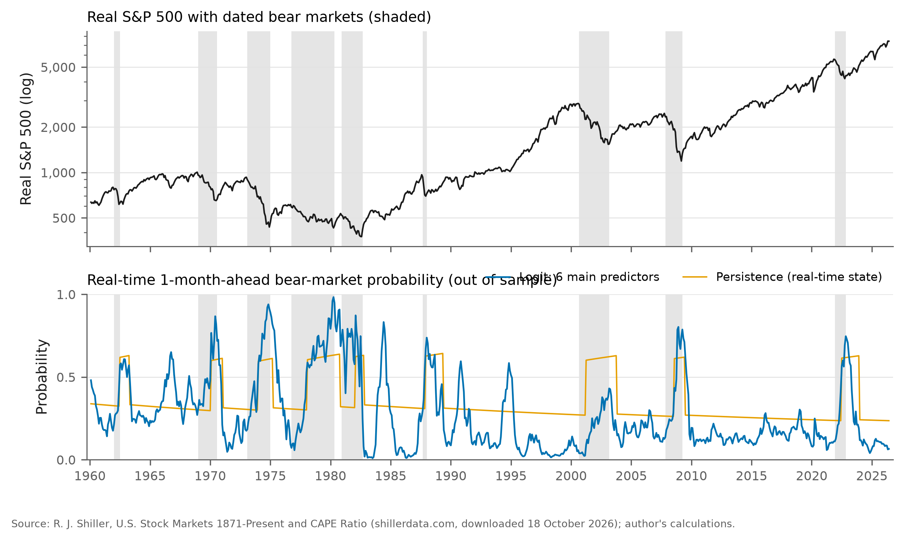

# Predictive Stochastic Modeling for Financial Markets

Can market and macroeconomic indicators forecast bear markets in the S&P 500? This repository
holds my undergraduate thesis on that question, which received the Adam Smith Award, and a
revised edition (v2) that rebuilds the analysis from Robert Shiller's primary data with a
corrected data alignment, a strictly real-time out-of-sample test, newer forecasting methods and
inference that accounts for the number of models compared.

The short answer from v2: a two-regime Markov-switching model describes the market well, and a
bear market is partly recognizable once it has started. At one month the best models improve on
simply knowing whether a bear market is under way, but that improvement is within sampling error
once the dependence of forecast errors and the number of models are taken into account, and
beyond six months nothing reliably beats the base rate.



- **Revised paper (v2):** [v2/paper/Predictive_Stochastic_Modeling_v2.pdf](v2/paper/Predictive_Stochastic_Modeling_v2.pdf)
- **Original award paper (February 2025):** [Predictive_Stochastic_Modeling_for_Financial_Markets.pdf](Predictive_Stochastic_Modeling_for_Financial_Markets.pdf)
- **Original R code:** [code.R](code.R)
- **The whole v2 pipeline in one script:** [v2/thesis.py](v2/thesis.py)
- **What changed and why:** [v2/NOTES.md](v2/NOTES.md)

## Key results

Real-time forecasts of a dated bear market (a 20% fall in the real S&P 500), made every month from
January 1960 to May 2026 with every model re-estimated on data available at the time. Brier
scores, lower is better; skill in parentheses is the reduction relative to the unconditional
frequency.

| Horizon | Unconditional | Persistence | MS-AR(1) filtered | Logit: dividend yield | Logit: 6 predictors | Gradient boosting | Best p vs persistence |
|---|---:|---:|---:|---:|---:|---:|---:|
| 1 month | 0.196 | 0.161 (17.6%) | 0.178 (9.1%) | 0.160 (18.3%) | 0.146 (25.4%) | 0.143 (26.8%) | 0.033 |
| 3 months | 0.196 | 0.177 (10.0%) | 0.191 (2.7%) | 0.170 (13.4%) | 0.172 (12.4%) | 0.171 (13.0%) | 0.131 |
| 6 months | 0.197 | 0.189 (3.9%) | 0.199 (−1.4%) | 0.180 (8.2%) | 0.193 (1.7%) | 0.221 (−12.3%) | 0.245 |
| 12 months | 0.197 | 0.197 (−0.2%) | 0.200 (−1.8%) | 0.194 (1.4%) | 0.203 (−3.2%) | 0.260 (−32.1%) | 0.350 |

*Persistence* is the bear frequency conditional on whether the market is currently in a
confirmed bear market. The last column is the smallest one-sided Diebold-Mariano p-value
(23-lag HAC window) of any of the 25 non-baseline models against persistence, before any
adjustment for the number of models. Hansen's test for superior predictive ability, which makes
that adjustment, gives p = 0.189 at one month and 0.468 across all horizons, and persistence is in
the 90% model confidence set at every horizon. Full tables: [v2/output/tables/](v2/output/tables).

- **Regimes.** In the MS-AR(1) model of monthly real returns (1960-2026) the bull regime has a mean
  of 0.88% and volatility of 2.41% per month; the bear regime has a mean of −1.75% and volatility
  of 5.57%. Expected durations are 16.6 and 5.0 months. Transition probabilities that depend on
  inflation and recent drawdowns fit better in sample (likelihood ratio 51.0) but do not forecast
  better out of sample.
- **In sample**, a high dividend yield, high inflation and a weak past year are associated with bear
  markets ([logit table](v2/output/tables/logit.md)).
- **Out of sample**, short-horizon gains over persistence come mainly from better calibration of the
  same information (Murphy decomposition). Elastic-net and gradient-boosting classifiers and
  dynamic model averaging do about as well as a plain logit at one month; the flexible models are
  the worst at long horizons.

## Data

Robert Shiller, *U.S. Stock Markets 1871-Present and CAPE Ratio* (`ie_data.xls`, sheet "Data"),
downloaded from [shillerdata.com](https://shillerdata.com/) on 18 October 2026 (server
last-modified date 6 October 2026), SHA-256
`98a54927942e842ec07ffe73000998e793953708c345b6b27bb363e9ada8366a`. A pristine copy is kept in
[v2/data/raw/ie_data.xls](v2/data/raw/ie_data.xls) (1.7 MB). The analysis uses January 1871 to
June 2026, the last month in which prices, dividends, earnings, CPI and the long-term rate are all
reported. The archived extract `one45.csv` used by the award version matches this workbook except
for 17 provisional observations in its final months (October 2023 to March 2024); see
[v2/output/tables/data_comparison.md](v2/output/tables/data_comparison.md).

## The data-alignment correction

Rebuilding the code exposed three errors in the award version, which a replication of its code
path on its own data confirms (correlation 1.000 with the published OLS coefficients and R²
values, 0.998 with its forecast ratios): its regime model regressed the price on a column that
holds next month's price, its "k months ahead" targets were built with `dplyr::lag` and so looked
backwards, and its "MSPE ratio" divided squared mean errors rather than mean squared errors. In v2
every predictor at month t uses only data published by the end of month t (CPI lagged one month,
dividends and earnings six months), bear markets are dated with an explicit rule, filtered rather
than smoothed probabilities are used for forecasts, and models are evaluated only on real-time
forecasts. Tests check that no feature or forecast changes when data after the forecast origin are
altered.

## Reproduce

Requires [uv](https://docs.astral.sh/uv/). From the repository root:

```bash
cd v2
uv sync                          # Python 3.12+, numpy, pandas, statsmodels, scikit-learn, matplotlib, xlrd, typst
uv run python thesis.py          # all stages from a clean output/ directory (about 25 minutes)
uv run python thesis.py data     # or any stages: data models forecast robust tables figures paper
uv run pytest                    # data, timing, labeling, metrics, regime and no-look-ahead tests
```

`thesis.py` verifies the SHA-256 of the pinned workbook (and downloads it from the URL in the
script if the file is missing), so a future Shiller update has to be adopted deliberately. The
pipeline is deterministic (fixed starting values and seeds, single process); two clean runs
produce identical outputs. Every number in the paper is read from `v2/output/numbers.json` or the
generated tables when the Typst source is compiled.

## Repository layout

```
one45.csv                         archived Shiller extract used by the award version (unchanged)
code.R, run_*.R, *.R              original R code and checked fitting lanes (unchanged)
Predictive_Stochastic_Modeling_for_Financial_Markets.pdf   original award paper (unchanged)
v2/
  thesis.py          the complete pipeline: data, features, dating, regime models, regressions,
                     real-time forecasting, machine learning, combinations, inference, tables,
                     figures and the paper build
  tests/             pytest suite
  data/raw/ie_data.xls          the pinned Shiller workbook
  data/archived_reported.csv    values transcribed from the award PDF
  output/            tables (Typst and Markdown), figures, result CSVs, numbers.json
  paper/             main.typ and the compiled PDF
  NOTES.md           what the original did, what was wrong, what v2 changes
```

## Original R workflow

The award-version code is preserved as it was. With R installed:

```bash
Rscript install_dependencies.R
Rscript run_research.R            # runs code.R on one45.csv
Rscript test_temporal.R           # past-only alignment checks
Rscript run_regime_core.R         # archived regime models
Rscript run_regime_core.R --past-only
```

These scripts reproduce the archived models, including the timing issues described above; use v2
for any forecasting conclusions.

## Author

Jaden Fix. Original thesis advised by Jonathan Kaplan.
